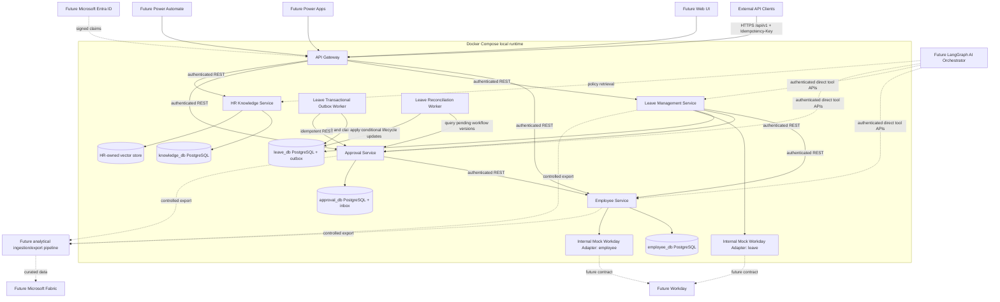

# Component Architecture

The gateway is mandatory for external clients. Internal service calls, including future AI tool calls, use direct authenticated REST APIs; every receiving service authorizes the caller and resource.
