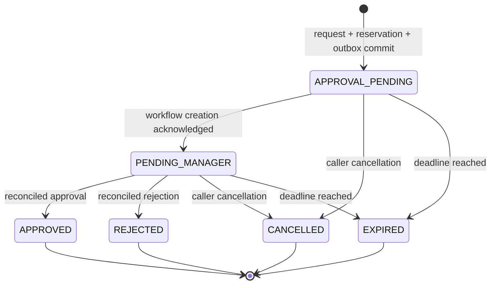
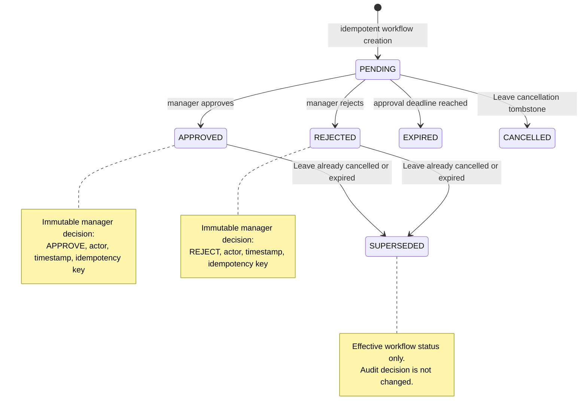

# Leave Lifecycle and Approval Statuses

Leave owns the effective request lifecycle: `APPROVAL_PENDING`, `PENDING_MANAGER`, `APPROVED`, `REJECTED`, `CANCELLED`, and `EXPIRED`. It owns balance reservations, releases, and consumption.

Approval owns workflow state: `PENDING`, `APPROVED`, `REJECTED`, `EXPIRED`, `CANCELLED`, and `SUPERSEDED`. It also owns immutable manager-decision records containing the decision, actor, timestamp, and idempotency key.

`SUPERSEDED` is an effective workflow state, not a changed decision. A decision remains in the approval audit forever. It becomes superseded when Leave has already cancelled or expired the request, so the decision has no leave effect.

Leave applies a reconciled decision only while its request is active and the decision occurred before the deadline. Cancellation or expiry locks the request row, changes lifecycle state, releases the reservation, and records a workflow-cancellation outbox event atomically.
