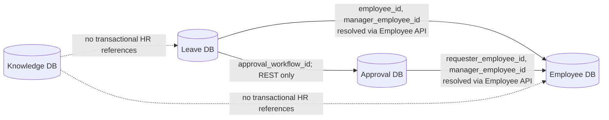
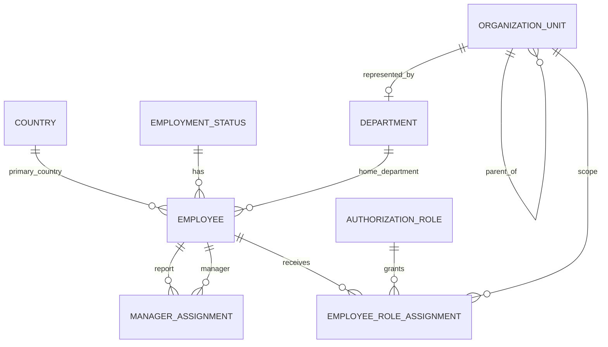
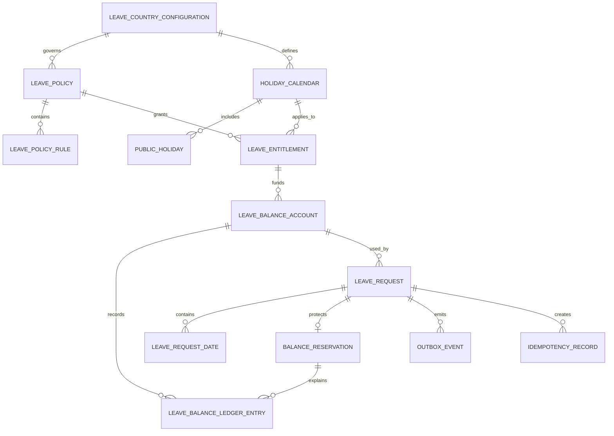
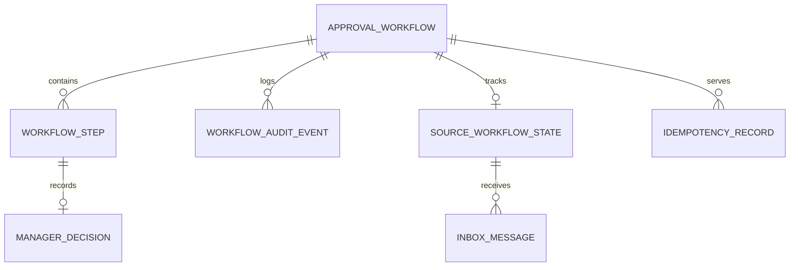
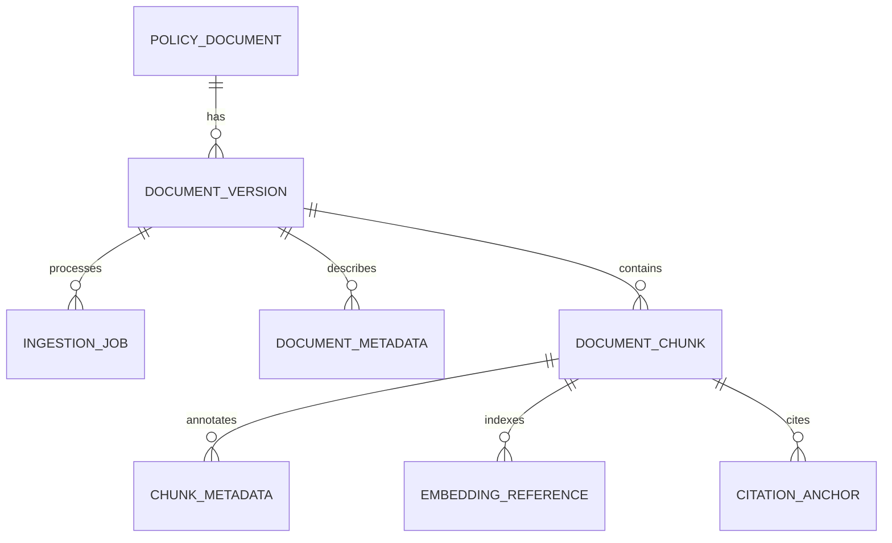

# Synthetic Data Model Proposal

## Status and Scope

This is a design-only proposal for synthetic-data modelling. It defines PostgreSQL-compatible logical entities, not SQL tables, ORM models, migrations, APIs, seed scripts, or generated records. Every service owns a separate database; identifiers from another service are opaque UUID values, not foreign keys.

All tables use `uuid` primary keys unless noted, `created_at timestamptz NOT NULL`, `updated_at timestamptz NOT NULL`, and an application-managed optimistic `row_version bigint NOT NULL`. Fields marked `NULL` are optional; every other listed attribute is mandatory. Monetary-style leave quantities use `numeric(12,2)`; timestamps use `timestamptz`; dates use `date`; all business codes are `varchar` with documented checks.

## Cross-Service References

`employee_id`, `manager_employee_id`, and `approval_workflow_id` are UUIDs copied from API responses. They are indexed locally but have no cross-database foreign key. Employee attributes and active manager relationships are retrieved through Employee Service. Leave owns leave calculations and balances; Approval owns decisions; Knowledge owns policy retrieval.

## 1. Employee Service — `employee_db`

### ER diagram

### Entity catalogue and data dictionary

| Entity | Purpose and attributes | Keys, relationships, and indexes | Rules |
|---|---|---|---|
| `countries` | Employee-owned reference: `country_code char(2)`, `name varchar(100)`, `default_time_zone varchar(64)`, `is_active boolean`. | PK `country_code`; unique `name`; index `(is_active)`. | ISO 3166-1 alpha-2 codes; `PL` active initially, `CZ` may be configured later. This is not a foreign-key target for other databases. |
| `employment_statuses` | Reference: `code varchar(32)`, `name varchar(100)`, `is_active boolean`. | PK `code`; unique `name`. | Initial synthetic codes include `ACTIVE`, `ON_LEAVE`, `TERMINATED`; legal/employment semantics remain configurable. |
| `organization_units` | Hierarchy: `id uuid`, `unit_code varchar(64)`, `name varchar(200)`, `unit_type varchar(32)`, `parent_unit_id uuid NULL`, `country_code char(2) NULL`, `effective_from date`, `effective_to date NULL`, `is_active boolean`. | PK `id`; self-FK `parent_unit_id`; unique `unit_code`; indexes `(parent_unit_id)`, `(country_code,is_active)`. | `unit_type` is constrained to configured values such as `LEGAL_ENTITY`, `DIVISION`, `TEAM`; parent cannot equal child; effective end is after start; hierarchy must be acyclic. |
| `departments` | Department classification: `id uuid`, `department_code varchar(64)`, `name varchar(200)`, `organization_unit_id uuid`, `cost_center_code varchar(64) NULL`, `effective_from date`, `effective_to date NULL`, `is_active boolean`. | PK `id`; FK `organization_unit_id → organization_units`; unique `department_code`; unique `organization_unit_id`; indexes `(is_active)`, `(cost_center_code)`. | A department maps to one organization unit; effective period must be valid. |
| `employees` | Synthetic worker projection: `id uuid`, `employee_number varchar(32)`, `given_name varchar(100)`, `family_name varchar(100)`, `work_email varchar(320)`, `country_code char(2)`, `primary_department_id uuid NULL`, `employment_status_code varchar(32)`, `employment_start_date date`, `employment_end_date date NULL`, `fte numeric(5,4)`, `workday_worker_id varchar(64) NULL`, `source_version varchar(128) NULL`. | PK `id`; FKs to `countries`, `departments`, `employment_statuses`; unique `employee_number`, unique `work_email`, unique non-null `workday_worker_id`; indexes `(primary_department_id)`, `(employment_status_code,country_code)`, `(family_name,given_name)`. | `fte` is `> 0` and `<= 1`; end date is after start; no real PII in synthetic fixtures. `workday_worker_id` is future projection metadata only. |
| `manager_assignments` | Effective-dated reporting line: `id uuid`, `employee_id uuid`, `manager_employee_id uuid`, `effective_from date`, `effective_to date NULL`, `assignment_source varchar(32)`. | PK `id`; both FKs to `employees`; unique `(employee_id,effective_from)`; indexes `(manager_employee_id,effective_from)`, `(employee_id,effective_from)`. | Manager differs from employee. An exclusion constraint on `daterange(effective_from,effective_to,'[]')` prevents overlapping manager assignments per employee. Manager must be an active employee for the relevant period. |
| `authorization_roles` | Role reference: `code varchar(32)`, `name varchar(100)`, `description text NULL`, `is_active boolean`. | PK `code`; unique `name`. | Initial roles: `EMPLOYEE`, `MANAGER`, `HR_ADMINISTRATOR`. |
| `employee_role_assignments` | Effective role grant: `id uuid`, `employee_id uuid`, `role_code varchar(32)`, `organization_unit_id uuid NULL`, `effective_from date`, `effective_to date NULL`, `granted_by_subject varchar(128) NULL`. | PK `id`; FKs to `employees`, `authorization_roles`, optional `organization_units`; unique `(employee_id,role_code,organization_unit_id,effective_from)` plus a partial unique rule for null-scope grants; indexes `(employee_id,effective_from)`, `(role_code,effective_from)`. | Scope is null for global grants; scoped roles apply only to the stated unit subtree after authorization rules are defined. Overlapping equivalent grants are prohibited. |

## 2. Leave Management Service — `leave_db`

### ER diagram

### Entity catalogue and data dictionary

| Entity | Purpose and attributes | Keys, relationships, and indexes | Rules |
|---|---|---|---|
| `leave_country_configurations` | Leave-local country configuration: `country_code char(2)`, `display_name varchar(100)`, `time_zone varchar(64)`, `weekend_iso_days smallint[]`, `is_enabled boolean`, `effective_from date`, `effective_to date NULL`. | PK `country_code`; index `(is_enabled)`. | `PL` is the only enabled first-release configuration. Store country data locally because Leave cannot FK to Employee DB. Weekend values are 1–7; any legal rules require policy validation. |
| `leave_policies` | Versioned policy header: `id uuid`, `policy_code varchar(64)`, `country_code char(2)`, `leave_type_code varchar(64)`, `name varchar(200)`, `unit varchar(16)`, `effective_from date`, `effective_to date NULL`, `is_active boolean`, `rule_set_version integer`. | PK `id`; FK `country_code`; unique `(country_code,policy_code,rule_set_version)`; index `(country_code,leave_type_code,effective_from)`. | Unit is `DAYS` or `HOURS`; effective intervals for the same policy/version cannot overlap. Values are configuration, not encoded country law. |
| `leave_policy_rules` | Ordered rule configuration: `id uuid`, `leave_policy_id uuid`, `rule_type varchar(64)`, `rule_config jsonb`, `sequence_no integer`, `is_mandatory boolean`. | PK `id`; FK to `leave_policies`; unique `(leave_policy_id,sequence_no)`; GIN index on `rule_config`. | Rule types are application-defined and validated against versioned schemas. Examples include eligibility, accrual, and rounding—not hardcoded legislation. |
| `holiday_calendars` | Calendar header: `id uuid`, `calendar_code varchar(64)`, `country_code char(2)`, `region_code varchar(32) NULL`, `calendar_year smallint`, `name varchar(200)`, `is_active boolean`. | PK `id`; FK `country_code`; unique `(country_code,region_code,calendar_year)` plus a partial unique rule for one null-region default per country/year; index `(country_code,calendar_year)`. | One default national calendar per country/year; regional variants must be explicit. |
| `public_holidays` | Calendar date: `id uuid`, `holiday_calendar_id uuid`, `holiday_date date`, `name varchar(200)`, `observed_date date NULL`, `is_working_day_override boolean`. | PK `id`; FK to `holiday_calendars`; unique `(holiday_calendar_id,holiday_date)`; index `(holiday_date)`. | One date per calendar; override distinguishes a holiday that is counted as working under a configured policy. |
| `leave_entitlements` | Employee eligibility/grant: `id uuid`, `employee_id uuid`, `leave_policy_id uuid`, `holiday_calendar_id uuid`, `effective_from date`, `effective_to date`, `employment_start_date_snapshot date`, `fte_snapshot numeric(5,4)`, `granted_units numeric(12,2)`, `unit varchar(16)`, `status varchar(16)`. | PK `id`; FKs to policy and calendar; indexes `(employee_id,effective_from)`, `(leave_policy_id,status)`; exclusion index prevents overlapping active entitlement periods for the same employee/policy. | `employee_id` is opaque. Units and FTE must be positive; policy unit must equal entitlement unit; effective interval must be valid. |
| `leave_balance_accounts` | Current balance projection per entitlement: `id uuid`, `leave_entitlement_id uuid`, `period_start date`, `period_end date`, `entitled_units numeric(12,2)`, `adjusted_units numeric(12,2)`, `consumed_units numeric(12,2)`, `reserved_units numeric(12,2)`, `available_units numeric(12,2)`, `account_status varchar(16)`. | PK `id`; FK to entitlement; unique `(leave_entitlement_id,period_start,period_end)`; indexes `(leave_entitlement_id,account_status)`. | `available_units = entitled_units + adjusted_units - consumed_units - reserved_units`; account totals must reconcile to ledger entries; reserved and consumed values cannot be negative. |
| `leave_balance_ledger_entries` | Immutable balance movement: `id uuid`, `balance_account_id uuid`, `leave_request_id uuid NULL`, `balance_reservation_id uuid NULL`, `entry_type varchar(32)`, `available_delta numeric(12,2)`, `reserved_delta numeric(12,2)`, `occurred_at timestamptz`, `correlation_id uuid`, `description text NULL`. | PK `id`; FKs to balance account, optional request/reservation; unique `(balance_account_id,correlation_id,entry_type)`; indexes `(balance_account_id,occurred_at)`, `(leave_request_id)`. | At least one delta is non-zero. Entries are append-only. Reservation, release, consumption, and adjustment must be balanced by configured accounting rules. |
| `leave_requests` | Request aggregate: `id uuid`, `requester_employee_id uuid`, `manager_employee_id uuid`, `leave_policy_id uuid`, `balance_account_id uuid`, `country_code_snapshot char(2)`, `leave_type_code_snapshot varchar(64)`, `status varchar(32)`, `submitted_at timestamptz`, `expires_at timestamptz`, `cancelled_at timestamptz NULL`, `finalized_at timestamptz NULL`, `requested_units numeric(12,2)`, `approval_workflow_id uuid NULL`, `approval_last_seen_version bigint NOT NULL`, `request_sequence integer NOT NULL`. | PK `id`; FKs to policy/account; indexes `(requester_employee_id,status)`, `(manager_employee_id,status)`, `(status,expires_at)`, `(approval_workflow_id)`; unique non-null `approval_workflow_id`. | Status is one of approved lifecycle states. Employee IDs and workflow ID are opaque. Requested units must equal the sum of request dates; a final request cannot be edited. |
| `leave_request_dates` | Per-day request detail: `id uuid`, `leave_request_id uuid`, `leave_date date`, `start_local_time time NULL`, `end_local_time time NULL`, `requested_units numeric(12,2)`, `day_kind varchar(16)`, `calculation_note text NULL`. | PK `id`; FK to leave request; unique `(leave_request_id,leave_date)`; indexes `(leave_date)`, `(leave_request_id)`. | `day_kind` is `FULL_DAY` or `PARTIAL_DAY`; partial days require valid times; dates must be within request policy/calendar applicability. Working-day calculation excludes configured weekends and holiday rules. |
| `balance_reservations` | Protected pending allocation: `id uuid`, `leave_request_id uuid`, `balance_account_id uuid`, `reserved_units numeric(12,2)`, `status varchar(16)`, `reserved_at timestamptz`, `released_at timestamptz NULL`, `consumed_at timestamptz NULL`, `expires_at timestamptz`, `release_reason varchar(64) NULL`. | PK `id`; FKs to request and account; unique `leave_request_id`; indexes `(balance_account_id,status)`, `(status,expires_at)`. | States are `ACTIVE`, `RELEASED`, `CONSUMED`, `EXPIRED`. Only one active reservation may exist per request; it is released only by lifecycle transition, never by a transient delivery failure. |
| `idempotency_records` | Mutating-request replay protection: `id uuid`, `actor_subject varchar(128)`, `operation varchar(128)`, `idempotency_key varchar(255)`, `request_hash char(64)`, `leave_request_id uuid NULL`, `response_status smallint`, `response_body jsonb`, `created_at timestamptz`, `expires_at timestamptz`. | PK `id`; optional FK to request; unique `(actor_subject,operation,idempotency_key)`; index `(expires_at)`. | Same key with a different hash is rejected; retained response makes retries stable. |
| `outbox_events` | Reliable outbound command: `id uuid`, `aggregate_type varchar(64)`, `leave_request_id uuid`, `sequence_no integer`, `event_type varchar(64)`, `payload jsonb`, `status varchar(16)`, `attempt_count integer`, `next_retry_at timestamptz`, `lease_owner varchar(128) NULL`, `lease_expires_at timestamptz NULL`, `last_error text NULL`, `occurred_at timestamptz`, `delivered_at timestamptz NULL`. | PK `id`; FK to request; unique `(aggregate_type,leave_request_id,sequence_no)`; indexes `(status,next_retry_at)`, `(lease_expires_at)`. | Event type includes `workflow.requested` and `workflow.cancelled`. Cancellation is a tombstone; events are immutable and status is delivery metadata only. |
| `workday_sync_states` | Future integration projection: `id uuid`, `entity_type varchar(64)`, `local_entity_id uuid`, `external_object_id varchar(128)`, `direction varchar(16)`, `source_version varchar(128) NULL`, `effective_at timestamptz NULL`, `sync_status varchar(32)`, `last_synced_at timestamptz NULL`, `conflict_detail jsonb NULL`. | PK `id`; unique `(entity_type,local_entity_id)` and `(entity_type,external_object_id)`; indexes `(sync_status,last_synced_at)`. | Holds synchronization state, never replaces Leave lifecycle or local ledger ownership in the prototype. Conflicts require review. |

## 3. Approval Service — `approval_db`

### ER diagram

### Entity catalogue and data dictionary

| Entity | Purpose and attributes | Keys, relationships, and indexes | Rules |
|---|---|---|---|
| `approval_workflows` | Local workflow aggregate: `id uuid`, `source_leave_request_id uuid`, `requester_employee_id uuid`, `manager_employee_id uuid`, `status varchar(16)`, `deadline_at timestamptz`, `created_at timestamptz`, `completed_at timestamptz NULL`, `effective_version bigint`, `source_request_sequence integer`. | PK `id`; unique `source_leave_request_id`; indexes `(manager_employee_id,status,deadline_at)`, `(status,deadline_at)`. | External IDs are opaque. Status is `PENDING`, `APPROVED`, `REJECTED`, `EXPIRED`, `CANCELLED`, or `SUPERSEDED`; the workflow has one manager step in v1. |
| `workflow_steps` | Assigned approval action: `id uuid`, `workflow_id uuid`, `sequence_no smallint`, `assignee_employee_id uuid`, `status varchar(16)`, `opened_at timestamptz`, `due_at timestamptz`, `completed_at timestamptz NULL`. | PK `id`; FK to workflow; unique `(workflow_id,sequence_no)`; indexes `(assignee_employee_id,status,due_at)`. | V1 permits exactly sequence `1`; assignee is an opaque Employee ID. A completed step cannot return to pending. |
| `manager_decisions` | Immutable manager choice: `id uuid`, `workflow_step_id uuid`, `decision varchar(16)`, `decided_by_employee_id uuid`, `decided_at timestamptz`, `reason text NULL`, `idempotency_key varchar(255)`, `request_hash char(64)`. | PK `id`; FK to step; unique `workflow_step_id`; unique `(workflow_step_id,idempotency_key)`; indexes `(decided_by_employee_id,decided_at)`. | Decision is `APPROVE` or `REJECT`; actor must equal the assigned manager as validated through Employee API. It is never updated or deleted when effective workflow status later becomes `SUPERSEDED`. |
| `workflow_audit_events` | Immutable transition log: `id uuid`, `workflow_id uuid`, `workflow_step_id uuid NULL`, `event_type varchar(64)`, `previous_status varchar(16) NULL`, `new_status varchar(16) NULL`, `actor_type varchar(32)`, `actor_id varchar(128) NULL`, `event_data jsonb`, `occurred_at timestamptz`, `workflow_version bigint`. | PK `id`; FKs to workflow and optional step; unique `(workflow_id,workflow_version)`; indexes `(workflow_id,occurred_at)`, `(event_type,occurred_at)`. | Append-only. Status transition and version must be consistent with workflow row. |
| `source_workflow_states` | Receiver-side source state/tombstone: `source_leave_request_id uuid`, `workflow_id uuid NULL`, `highest_sequence_no integer`, `cancellation_sequence_no integer NULL`, `is_cancelled boolean`, `updated_at timestamptz`. | PK `source_leave_request_id`; optional FK to workflow; unique non-null `workflow_id`; indexes `(is_cancelled,updated_at)`. | A cancellation tombstone is retained even if workflow creation has not arrived. A create at or below a cancellation sequence cannot create an active workflow. |
| `idempotency_records` | Decision/API replay protection: `id uuid`, `actor_subject varchar(128)`, `operation varchar(128)`, `idempotency_key varchar(255)`, `request_hash char(64)`, `workflow_id uuid NULL`, `response_status smallint`, `response_body jsonb`, `created_at timestamptz`, `expires_at timestamptz`. | PK `id`; optional FK to workflow; unique `(actor_subject,operation,idempotency_key)`; index `(expires_at)`. | Conflicting reuse of a key is rejected; stored response is returned on identical replay. |
| `inbox_messages` | Processed source event record: `event_id uuid`, `source_service varchar(64)`, `source_leave_request_id uuid`, `sequence_no integer`, `event_type varchar(64)`, `payload_hash char(64)`, `received_at timestamptz`, `processed_at timestamptz`, `processing_result varchar(32)`. | PK `event_id`; FK `source_leave_request_id → source_workflow_states`; unique `(source_service,source_leave_request_id,sequence_no)`; indexes `(source_leave_request_id,sequence_no)`, `(received_at)`. | Same event ID is idempotent; same sequence with a different payload hash is a conflict and must not change workflow state. |

## 4. HR Knowledge Service — `knowledge_db` and owned vector store

### ER diagram

### Entity catalogue and data dictionary

| Entity | Purpose and attributes | Keys, relationships, and indexes | Rules |
|---|---|---|---|
| `policy_documents` | Logical policy identity: `id uuid`, `document_key varchar(128)`, `title varchar(500)`, `document_type varchar(32)`, `country_code char(2) NULL`, `access_classification varchar(32)`, `status varchar(32)`, `owner_subject varchar(128) NULL`. | PK `id`; unique `document_key`; indexes `(status,country_code)`, `(access_classification)`. | `document_type` is `PDF`, `DOCX`, or `MARKDOWN`; country code is metadata, not an Employee or Leave FK. |
| `document_versions` | Immutable uploaded/retrieved version: `id uuid`, `policy_document_id uuid`, `version_no integer`, `source_uri text`, `content_sha256 char(64)`, `mime_type varchar(100)`, `language_code varchar(16)`, `source_published_at timestamptz NULL`, `ingestion_status varchar(32)`, `is_current boolean`. | PK `id`; FK to document; unique `(policy_document_id,version_no)`; unique `(policy_document_id,content_sha256)`; partial unique index on current version per document; indexes `(ingestion_status,created_at)`. | Content itself belongs in approved object storage or synthetic fixture source, not necessarily a relational text field. At most one current version exists. |
| `ingestion_jobs` | Processing attempt: `id uuid`, `document_version_id uuid`, `status varchar(32)`, `attempt_no integer`, `requested_by_subject varchar(128) NULL`, `started_at timestamptz NULL`, `completed_at timestamptz NULL`, `error_code varchar(64) NULL`, `error_detail text NULL`, `metrics jsonb`. | PK `id`; FK to version; unique `(document_version_id,attempt_no)`; indexes `(status,created_at)`, `(document_version_id,attempt_no)`. | Status is queued/running/succeeded/failed/cancelled; completion cannot precede start. |
| `document_metadata` | Version-level typed metadata: `id uuid`, `document_version_id uuid`, `metadata_key varchar(128)`, `metadata_value jsonb`, `is_filterable boolean`. | PK `id`; FK to version; unique `(document_version_id,metadata_key)`; GIN index on `metadata_value`; index `(metadata_key)` for filterable entries. | Keys use controlled vocabulary, such as `policy_area`, `audience`, and `effective_date`. |
| `document_chunks` | Extracted searchable text: `id uuid`, `document_version_id uuid`, `ordinal integer`, `text_content text`, `char_start integer`, `char_end integer`, `token_count integer`, `content_sha256 char(64)`, `page_number integer NULL`, `section_path text NULL`. | PK `id`; FK to version; unique `(document_version_id,ordinal)`; indexes `(document_version_id,ordinal)`, `(content_sha256)`. | `char_start < char_end`; ordinal is positive; chunk content is derived from an approved policy document, never employee data. |
| `chunk_metadata` | Chunk-level metadata: `id uuid`, `document_chunk_id uuid`, `metadata_key varchar(128)`, `metadata_value jsonb`, `is_filterable boolean`. | PK `id`; FK to chunk; unique `(document_chunk_id,metadata_key)`; GIN index on `metadata_value`. | Used for section, policy topic, and country filters. |
| `embedding_references` | Vector-store pointer: `id uuid`, `document_chunk_id uuid`, `embedding_model varchar(128)`, `embedding_dimension integer`, `vector_store_name varchar(128)`, `vector_collection varchar(128)`, `vector_id varchar(128)`, `embedded_content_sha256 char(64)`, `created_at timestamptz`. | PK `id`; FK to chunk; unique `(document_chunk_id,embedding_model)`; unique `(vector_store_name,vector_collection,vector_id)`; indexes `(embedding_model,created_at)`. | The vector remains in the HR Knowledge-owned vector store. The content hash must match the chunk version used for embedding. |
| `citation_anchors` | Stable source location: `id uuid`, `document_chunk_id uuid`, `citation_label varchar(256)`, `page_number integer NULL`, `section_path text NULL`, `source_locator text NULL`. | PK `id`; FK to chunk; unique `(document_chunk_id,citation_label)`; index `(citation_label)`. | A retrieval response builds citations from these immutable anchors and the selected document version. |

## Relationships and Cardinalities

- An organization unit has zero or many child units; a department maps to exactly one organization unit; an employee has zero or one primary department.
- An employee has many effective-dated manager assignments and role assignments. A current manager is selected by the effective date, not a mutable column on `employees`.
- A leave policy has many rules and many entitlements. An entitlement has one or more balance accounts for defined periods.
- A leave request has one or more request-date rows and at most one balance reservation. A reservation and its request can have many immutable ledger entries.
- A leave request emits many outbox events in strictly increasing sequence order. Its Approval workflow ID is an opaque local reference only.
- An Approval workflow has exactly one workflow step in v1, at most one immutable manager decision per step, and many audit events.
- A policy document has many versions; each version has many ingestion jobs, metadata records, chunks, and each chunk can have metadata, embeddings, and citation anchors.

## Database Ownership Matrix

| Database | Owner | Authoritative data | Remote references / access |
|---|---|---|---|
| `employee_db` | Employee Service | Employee identity projection, organization, manager history, employment status, roles | Leave and Approval retrieve employee/manager facts through Employee API. |
| `leave_db` | Leave Management Service | Country policy configuration, holidays, entitlements, balances, reservations, requests, outbox, Workday sync state | Stores opaque Employee and Approval UUIDs; reads their facts through authenticated APIs. |
| `approval_db` | Approval Service | Workflow state, immutable decisions/audit, inbox/tombstones | Stores opaque Leave and Employee UUIDs; receives Leave commands and queries Employee API. |
| `knowledge_db` plus vector store | HR Knowledge Service | Policy documents, ingestion/retrieval metadata, chunks, embeddings, citations | No transactional HR data; serves retrieval through its API. |

No service may query another database, add a cross-database foreign key, or use a distributed transaction.

## Business Constraints and Validation Rules

1. **Country configuration:** Poland is the only enabled country at first. Czechia and later countries are represented by country-coded configuration, policies, and calendars; no country-specific leave rule is hardcoded in the model.
2. **Policy correctness:** `leave_policy_rules.rule_config` needs a versioned schema. Values shown in synthetic fixtures are demonstrations only and must not be treated as legal entitlement rules.
3. **Balance integrity:** Only immutable ledger entries change financial-style balance totals. A request reserves units atomically with its initial outbox event. Approval does not change leave balances.
4. **Request calculation:** The requested units equal the sum of `leave_request_dates`. Calculation uses the request's policy, FTE snapshot, country calendar, weekends, and holidays. Partial-day support requires a configured unit conversion/rounding rule.
5. **Lifecycle integrity:** A final request is immutable. Cancellation or expiration releases an active reservation and emits an ordered cancellation tombstone. A late Approval decision cannot revive a cancelled or expired Leave request.
6. **Approval integrity:** A manager decision requires an active assignment confirmed by Employee Service. `SUPERSEDED` changes effective workflow status only; no decision row is overwritten.
7. **Outbox integrity:** Event sequence is monotonic per leave request. Approval keeps source state and inbox messages, so duplicate or stale creates cannot create an active workflow after cancellation.
8. **Data minimization:** Synthetic names, emails, and policy text must be fictional. Knowledge documents cannot contain real employee or production HR information.
9. **Workday:** Prototype services remain authoritative for synthetic records. Future Workday synchronization uses explicit field/process ownership, source versions, effective dates, and manual conflict review.

## Synthetic Dataset Design

### Identifier and generation strategy

Use a fixed fixture seed and deterministic UUIDv5 namespaces. Generate a shared `employee_id` from a fictional `employee_number`; reuse only that opaque UUID in Leave and Approval fixtures. Generate service-local UUIDs from each service namespace. This produces referentially consistent fixtures without cross-database constraints.

Use `generated_at` and `fixture_set_version` only in fixture manifests, not as business data. Faker locales may generate Polish-appropriate fictional names, but all email domains use a reserved example domain such as `example.test`.

### Proposed fixture packs

| Pack | Suggested scale and contents | Purpose |
|---|---|---|
| Organization | 1 fictional legal entity, 3 divisions, 12 departments, 40 organization units, 500 employees, 75 managers | Hierarchy, manager lookup, roles, part-time workers, start/end dates. |
| Country and policy | `PL` enabled; `CZ` disabled extension configuration; 3 synthetic `DEMO_*` leave policy versions; 2 calendar years | Configuration extensibility. Any quantities are illustrative and not legal advice. |
| Calendar | Poland synthetic/public-holiday-shaped calendar entries plus regional-variant fixture | Weekend, holiday, observed-date, and cross-year calculation tests. Actual statutory calendars require later validation. |
| Balance and request | 500 entitlements/accounts, ledger opening/adjustment entries, active and released reservations, 100–200 requests | Balance projection and lifecycle invariants. |
| Approval | Matching workflows for submitted requests, one single step each, decisions and audit records, cancellation tombstones | Idempotency, out-of-order delivery, reconciliation, and `SUPERSEDED` audit behavior. |
| Knowledge | 20–30 fictional PDF/DOCX/Markdown policy documents, multiple versions, chunks, citations, and embedding references | Ingestion, document versioning, filters, and citations. |

### Required edge cases

- Employee changes manager during a pending request; approval uses the workflow's assigned-manager snapshot while authorization validates the current approved rule.
- Part-time employee with a policy-defined fractional request unit.
- Employment begins or ends within an entitlement period.
- Request spanning a weekend, holiday, year boundary, and a regional-calendar variant.
- Insufficient available balance, duplicate submission key, and the same key with a changed payload.
- Cancellation before workflow creation, create delivered twice, cancellation delivered before create, and a stale create after cancellation tombstone.
- Approval immediately before expiry; approval after expiry; cancellation racing with approval; a superseded workflow retaining its immutable decision.
- Outbox failure through the maximum retry count, audited redrive, and reconciliation version replay.
- Document re-ingestion with identical content, revised content, failed extraction, duplicate chunk, stale embedding, and citation to an older version.

## Future AI Orchestrator Data Requirements

Do not design the Orchestrator database yet. Its future separate store will need agent-session identifiers, workflow state/checkpoints, tool-call audit records, human-review states, prompt/tool versions, evaluation traces, and retention metadata. It must store only controlled API references, never authoritative Employee, Leave, Approval, or Knowledge records.

## Assumptions and Open Questions

1. Synthetic policy values and calendars are examples only; Polish legal entitlements, carry-over, parental/sick leave, and public holiday rules require HR/legal validation before implementation.
2. Confirm the supported leave types, entitlement periods, accrual cadence, partial-day unit, rounding, request-expiry period, and post-approval cancellation policy.
3. Confirm whether regional holiday calendars and multiple concurrent employment contracts are in v1 scope.
4. Confirm retention periods for idempotency records, audit events, Workday sync state, and policy document versions.
5. Confirm local-development identity claims and which role grants may be scoped to an organization unit.
6. Confirm the future Workday transport and the field/process-level source-of-truth matrix before live synchronization.

This proposal preserves the approved service boundaries, direct authenticated internal APIs, API Gateway external boundary, transactional outbox, and no-broker prototype architecture.
